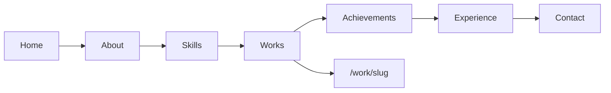

# Sushanth Bandari Portfolio

A dark, editorial portfolio that reads as one product: ink backgrounds, olive from the hero jacket, and a small amount of gold from the chatbot portrait. Copy stays inside [MY_PORTFOLIO.txt](MY_PORTFOLIO.txt). Nothing is invented (no college, GPA, or extra jobs).

## Content rules

Use only what the file documents.

- **Identity:** Sushanth Bandari, Hyderabad, India. Open to internships. Languages: English, Telugu, Hindi.
- **Contact:** `sushanth1208@gmail.com` (the file has a doubled `@`; the site will use one). Phone `+91 8919741818`. LinkedIn, GitHub, X, Instagram as written.
- **Role line:** Full-stack developer and AI builder. Pillars already in the file: problem solving, full-stack, UI/UX, AI, machine learning, programming.
- **Stats that match visible proof:** 7 documented products, Top 2% of 40,000+ builders (HCL GUVI / India AI Impact Buildathon), 2nd Runner-up at NASSCOM GENAI Forge, Guinness World Records Agentathon participant, one internship (WiseAcad by SuntekCorp, Apr–Jun 2026, Hyderabad, on-site).
- The file also says “10+ projects, 8+ hackathon finalists, 2x hackathon wins,” but only 7 projects and the achievements above are written out. The hero will not show counts the case studies cannot back up. Those three lines can be added later when the missing work is supplied.
- **About photos** are in the folder but unnamed in the brief: [assets/about1.jpg](assets/about1.jpg), [assets/about2.jpg](assets/about2.jpg), [assets/about3.jpg](assets/about3.jpg). [assets/summit.jpg](assets/summit.jpg) pairs with the India AI Impact Summit entry. There is no `profile.jpg` or `hcl.jpg`; the hero uses [assets/home.png](assets/home.png), and the HCL slideshow uses `hcl1.jpg` and `hcl2.jpg`.

## Visual system

- **Palette:** `#07080B` ink, `#12151C` raised surfaces, `#E7E2D6` ivory text, `#8C9A62` olive (primary action), `#E4C15A` gold (chat and awards only). Contrast checked for WCAG AA on text and buttons.
- **Type:** Fraunces for the name and section titles, Plus Jakarta Sans for UI and body. Loaded with `next/font`.
- **Motion:** Slow olive/gold mesh behind the hero, portrait float, section fade-up, card hover lift. `prefers-reduced-motion` turns this off. No blocking loader. [assets/chatbot.png](assets/chatbot.png) is the chat avatar, not a gate in front of the page (a splash would hurt first paint and recruiter patience).
- **Hero:** Name, one-sentence positioning, “Open to internships,” Hyderabad, primary “View work” and secondary “Contact.” Cutout from `home.png` on the mesh. If the PNG is flattened on black instead of transparent, mask it during build.
- **Logos:** `simple-icons` for skills, tools, and socials (React, Node, Python, FastAPI, MongoDB, Docker, Azure, GCP, Figma, and the rest that exist). Missing marks (Groq, Cursor, v0, Antigravity, some org marks) get a small monogram tile so the grid never has a broken image. Organization names stay as text next to photos: HCL GUVI, NASSCOM, GDG Hyderabad, ISRO / SIH, WiseAcad by SuntekCorp, Telangana Police / Disaster Management.

## Information architecture

Single scrolling page for the visit, plus a case-study URL per project so each product can be shared and indexed.

- Sticky nav: Home, About, Skills, Works, Achievements, Experience, Contact. Mobile: full-screen menu, 44px targets, focus trap.
- **About:** short narrative (Hyderabad-based builder, internship, languages, what he ships) and a three-photo strip.
- **Skills:** three groups from the file — languages and web, AI and data, tools and platforms — as logo chips, not a wall of bars with made-up percentages.
- **Works:** seven cards. Filter chips: All, AI, Full-stack, Mobile, Civic. Each card: name, client or context, one-line outcome, stack logos, GitHub, and live link when it exists (ServiceDesk Pro, Tark AI).
- **Case studies** at `/work/[slug]`: problem, what shipped, stack, AI integration, use cases, links. Order: DhvaniSense, Coffee-with-Cinema, ServiceDesk Pro, iTantra, Intelli-Credit, Pravaha, Tark AI.
- **Achievements:** horizontal story cards with the photo sets (HCL slideshow, NASSCOM, Agentathon trio, summit). Each links to certificate, LinkedIn post, and the related project.
- **Experience:** one role card for WiseAcad by SuntekCorp. ServiceDesk Pro is called out as the product from that internship.
- **Contact:** mail, phone, and socials with logos. Copy-to-clipboard. `mailto:` is the send path so the site stores no messages and needs no secret keys. A short note repeats “Open to internships.”
- **Resume:** `/resume` is a print-ready page from the same content (no PDF was provided). Header and footer include “Download resume,” which opens that page and the browser print dialog.

## Chatbot

A panel anchored bottom-right, avatar from `chatbot.png`, keyboard-operable, labeled for screen readers.

Answers come only from a typed knowledge file shared with the page (projects, achievements, experience, skills, contact, location, internship status). Matching is local: intent keywords plus a small set of hiring prompts (“What have you built?”, “Are you open to internships?”, “Walk me through DhvaniSense”, “How do I contact you?”). If nothing matches, it says so and offers Contact. No API key, no resume text sent to a third party.

Suggested questions sit above the input so a recruiter can click instead of typing.

## Tech and quality bar

- **Stack:** Next.js (App Router) + TypeScript + Tailwind CSS + Framer Motion. Content lives in `content/portfolio.ts` so the page, case studies, resume, and chatbot cannot drift apart.
- **SEO:** unique titles and descriptions, Open Graph, `Person` JSON-LD, semantic headings, descriptive alt text, sitemap and robots.
- **A11y:** skip link, landmarks, visible focus, AA contrast, reduced motion, form labels, chat not trapped behind a mouse-only control.
- **Security:** no secrets in the client, external links `rel="noopener noreferrer"`, contact via `mailto` and `tel`, chatbot cannot be prompted into facts outside the knowledge file.
- **GitHub:** every project links to the repo in the file. Public profile link in the header and contact. Live star counts are skipped; the unauthenticated API is rate-limited and would fail in front of recruiters.
- **Responsive:** layout checked at phone, tablet, and desktop widths, including the chat panel and the mobile menu.

## Build shape

New app in this folder, assets moved to `public/assets/`. Main files: `app/page.tsx`, `app/work/[slug]/page.tsx`, `app/resume/page.tsx`, `content/portfolio.ts`, `content/knowledge.ts`, `components/ChatWidget.tsx`, section components, and global styles.